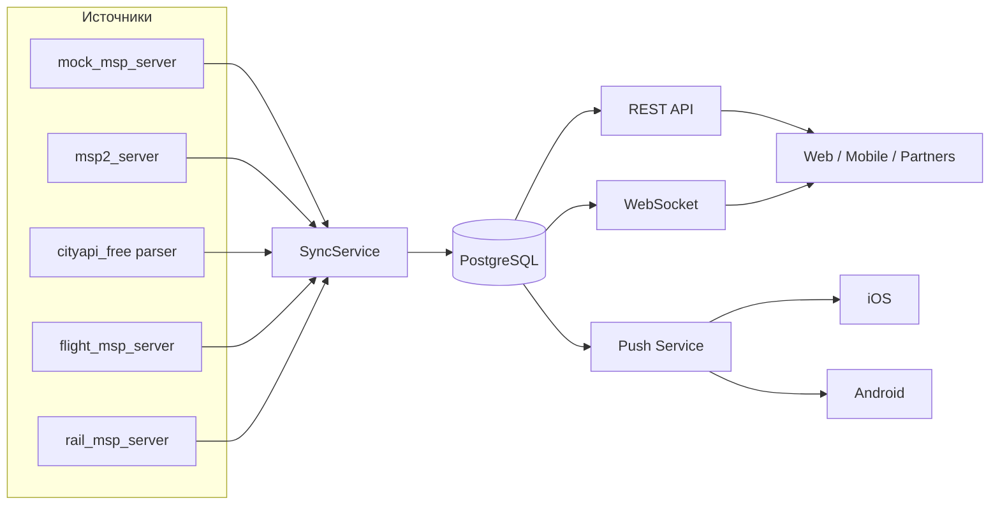

<div align="center">


<a href="https://github.com/JamikKhidirov/TravelGo">
  
</a>

<p>
  <a href="https://github.com/JamikKhidirov/TravelGo/actions/workflows/ci.yml"></a>
  <a href="https://github.com/JamikKhidirov/TravelGo/releases/latest"></a>
  
  
  
  
  
  
  
</p>

<p>
  <a href="#быстрый-старт">Быстрый старт</a> ·
  <a href="#документация">Документация</a> ·
  <a href="#api">API</a> ·
  <a href="#билеты-и-msp">Билеты</a> ·
  <a href="#push-уведомления">Push</a> ·
  <a href="#деплой-на-vps">VPS</a> ·
  <a href="#релизы">Релизы</a>
</p>

</div>

---

## О проекте

**GoTravel** — backend-прослойка между клиентами и несколькими travel MSP-серверами. Сервис забирает направления, туры, ваучеры и билеты из разных источников, нормализует и объединяет данные, хранит их в PostgreSQL и отдаёт клиенту через единый REST API, WebSocket и push-уведомления.

Клиенту не нужно знать про десятки MSP: он работает с одним API.



## Возможности

- **MSP-агрегатор:** несколько MSP-источников + публичный парсер CityAPI.
- **Направления и туры:** CRUD, поиск, топ, страны, пагинация.
- **Билеты:** авиа, ЖД и автобусы; фильтры по городу, направлению, типу и дате.
- **Городские пакеты:** `GET /api/v1/cities/{city}/packages` — направления, туры, ваучеры и билеты по городу.
- **Корзина и заказы:** добавление туров, checkout, статусы, отмена.
- **Оплаты:** создание и подтверждение платежа.
- **Отзывы и ваучеры:** рейтинг, комментарии, CRUD ваучеров.
- **Аутентификация:** JWT HS256 access token + ротируемые refresh-токены, сессии в БД.
- **MFA:** TOTP для Google Authenticator и WebAuthn/passkeys.
- **Устройства и сессии:** список устройств, IP, время входа, отзыв сессии и «выйти на всех устройствах».
- **OAuth2/OIDC:** authorization code + PKCE (S256) для мобильных клиентов, userinfo и discovery.
- **RBAC/ABAC:** гид видит только свои туры, партнёр — только назначенные заказы.
- **WebSocket:** геолокация, комнаты, presence, live-обновления.
- **Push:** регистрация iOS/Android устройств и админская рассылка через FCM.
- **Админка:** встроенная панель `/admin` со статистикой и отправкой push.
- **Swagger + Postman:** полная OpenAPI-спецификация и готовая коллекция.
- **Docker + CI/CD:** compose, GitHub Actions, релизные бинарники.

## Быстрый старт

### Docker (рекомендуется)

```bash
git clone https://github.com/JamikKhidirov/TravelGo.git
cd TravelGo
docker compose up -d --build
```

Откройте:

| Сервис | URL |
|---|---|
| API | http://localhost:8080 |
| Swagger UI | http://localhost:8080/swagger/index.html |
| Admin panel | http://localhost:8080/admin |
| Health | http://localhost:8080/health |
| WebSocket | ws://localhost:8080/ws?room=global |

Первичная синхронизация:

```bash
curl -X POST http://localhost:8080/api/v1/sync
```

Остановка:

```bash
docker compose down
```

### Локально

```bash
go mod tidy
go run ./cmd/server
```

Нужны PostgreSQL и Redis, параметры — в `configs/config.yaml` или через переменные окружения.

Пул подключений PostgreSQL настраивается в `configs/config.yaml`:

```yaml
db:
  max_open_conns: 25
  max_idle_conns: 10
  conn_max_lifetime: 5m
```

или переменными `DB_MAX_OPEN_CONNS`, `DB_MAX_IDLE_CONNS`, `DB_CONN_MAX_LIFETIME`.
Время жизни idle-соединения — 2 минуты. При старте сервер пишет в лог
`db pool configured` с фактическими значениями.

Секрет для JWT задаётся переменной `JWT_SECRET`. В production сервер не стартует без
неё; в dev/docker используется значение по умолчанию (только для разработки).

## Документация

| Документ | Описание |
|---|---|
| [REST API](docs/REST.md) | Все эндпоинты, авторизация, пагинация, примеры `curl` |
| [WebSocket](docs/WEBSOCKET.md) | Геолокация, комнаты, presence, формат сообщений |
| [Архитектура](docs/ARCHITECTURE.md) | Слои, синхронизация, билеты, push |
| [Деплой на VPS](docs/DEPLOYMENT.md) | Ubuntu, Docker, Nginx/Caddy, TLS, backup, systemd |
| [Swagger UI](http://localhost:8080/swagger/index.html) | Интерактивная документация локально |
| [OpenAPI YAML](api/swagger/swagger.yaml) | Спецификация OpenAPI 3.0 |
| [Postman](postman/go-travel.postman_collection.json) | Коллекция запросов |
| [docs/README.md](docs/README.md) | Индекс документации |

## API

Базовый URL: `http://localhost:8080/api/v1`

Авторизация:

```http
Authorization: Bearer <access_token>
```

JWT access token (HS256) дополняется одноразовым refresh-токеном; каждая сессия
хранится в БД и привязана к устройству, IP и времени входа. Для локальной разработки
остаётся fallback `X-User-Id` / `X-User-Role`.

Роли: `user`, `guide`, `partner`, `admin`. Гид видит и редактирует только свои туры,
партнёр — только назначенные ему заказы, админ-маршруты `/admin/*` требуют роль `admin`.

Основные группы:

| Группа | Префикс |
|---|---|
| Направления | `/destinations` |
| Туры | `/tours` |
| Билеты | `/tickets` |
| Городские пакеты | `/cities/{city}/packages` |
| Синхронизация | `/sync` |
| Auth | `/auth` |
| OAuth2/OIDC | `/oauth`, `/.well-known/openid-configuration` |
| Корзина | `/cart` |
| Заказы | `/orders` |
| Оплаты | `/payments` |
| Отзывы | `/reviews` |
| Ваучеры | `/vouchers` |
| Устройства и сессии | `/auth/sessions`, `/auth/devices` |
| Админ | `/admin` |

Пример регистрации и логина:

```bash
curl -X POST http://localhost:8080/api/v1/auth/register \
  -H "Content-Type: application/json" \
  -H "X-Device-Name: MacBook Pro" \
  -H "X-Device-Platform: web" \
  -d '{"email":"user@example.com","password":"password123","first_name":"John","last_name":"Doe"}'

curl -X POST http://localhost:8080/api/v1/auth/login \
  -H "Content-Type: application/json" \
  -H "X-Device-Name: iPhone 15" \
  -H "X-Device-Platform: ios" \
  -d '{"email":"user@example.com","password":"password123"}'
```

Список устройств и сводка по аккаунту:

```bash
curl http://localhost:8080/api/v1/auth/sessions \
  -H "Authorization: Bearer $TOKEN"
```

Выход на всех устройствах:

```bash
curl -X POST http://localhost:8080/api/v1/auth/logout-all \
  -H "Authorization: Bearer $TOKEN"
```

MFA (TOTP, Google Authenticator):

```bash
curl -X POST http://localhost:8080/api/v1/auth/mfa/setup -H "Authorization: Bearer $TOKEN"
curl -X POST http://localhost:8080/api/v1/auth/mfa/enable \
  -H "Content-Type: application/json" -H "Authorization: Bearer $TOKEN" \
  -d '{"code":"123456"}'
```

OAuth2/OIDC с PKCE для мобильных клиентов:

```bash
curl -X POST http://localhost:8080/api/v1/oauth/authorize \
  -H "Content-Type: application/json" -H "Authorization: Bearer $TOKEN" \
  -d '{"client_id":"gotravel-mobile","redirect_uri":"gotravel://callback","scope":"openid profile email","code_challenge":"<S256>","code_challenge_method":"S256"}'

curl -X POST http://localhost:8080/api/v1/oauth/token \
  -H "Content-Type: application/json" \
  -d '{"grant_type":"authorization_code","code":"<code>","redirect_uri":"gotravel://callback","client_id":"gotravel-mobile","code_verifier":"<verifier>"}'
```

Подробные примеры — в [docs/REST.md](docs/REST.md).

Пример билетов:

```bash
curl "http://localhost:8080/api/v1/tickets?type=flight&origin=Moscow&destination=Istanbul"
curl "http://localhost:8080/api/v1/tickets?type=train&page_size=20"
curl "http://localhost:8080/api/v1/cities/Moscow/packages"
```

## Билеты и MSP

Источники синхронизации:

| Источник | Данные |
|---|---|
| `mock_msp_server` | направления, туры, билеты (flight/train/bus) |
| `msp2_server` | направления, туры, билеты |
| `cityapi_free` | публичный парсер стран и столиц |
| `flight_msp_server` | авиабилеты |
| `rail_msp_server` | ЖД-билеты |

Все билеты сохраняются в таблицу `tickets` с уникальностью `(source, external_id)`, поэтому повторный sync обновляет данные, а не плодит дубликаты. Клиент получает объединённый список из `/api/v1/tickets`.

Добавление нового MSP:

1. Реализуйте `Name`, `FetchDestinations`, `FetchTours`.
2. Для билетов дополнительно реализуйте `FetchTickets`.
3. Добавьте источник в `service.NewSyncService(...)` в `cmd/server/main.go`.

## WebSocket

```js
const ws = new WebSocket(
  "ws://localhost:8080/ws?room=global&user_id=11111111-2222-3333-4444-555555555555&name=Traveler"
);

ws.onopen = () => {
  ws.send(JSON.stringify({
    type: "location",
    location: { lat: 55.7558, lng: 37.6173, accuracy: 10 }
  }));
};

ws.onmessage = (event) => {
  const msg = JSON.parse(event.data);
  if (msg.type === "presence") console.log("online:", msg.payload);
  if (msg.type === "location") console.log("moved:", msg.user_id, msg.location);
};
```

Подробнее: [docs/WEBSOCKET.md](docs/WEBSOCKET.md).

## Push-уведомления

1. Мобильное приложение получает FCM/APNs токен.
2. Регистрирует его:

```bash
curl -X POST http://localhost:8080/api/v1/devices/register \
  -H "Content-Type: application/json" \
  -H "X-User-Id: $USER_ID" \
  -d '{"platform":"android","token":"fcm-token","app_version":"1.0.0"}'
```

3. Админ отправляет push из панели `http://localhost:8080/admin` или через API:

```bash
curl -X POST http://localhost:8080/api/v1/admin/push \
  -H "Content-Type: application/json" \
  -d '{"user_id":"<uuid>","title":"GoTravel","body":"New tours","data":{"screen":"tours"}}'
```

Для реальной доставки задайте `FCM_SERVER_KEY` (Firebase Cloud Messaging доставляет и на Android, и на iOS). Без ключа используется `log`-провайдер.

## Деплой на VPS

Кратко:

```bash
sudo apt update && sudo apt install -y docker.io docker-compose-plugin git
git clone https://github.com/JamikKhidirov/TravelGo.git
cd TravelGo
docker compose up -d --build
```

Затем настройте Nginx/Caddy, TLS и `wss://`. Полная инструкция: [docs/DEPLOYMENT.md](docs/DEPLOYMENT.md).

## Релизы

Релиз создаётся автоматически при пуше тега `v*`:

```bash
git tag v1.4.0
git push origin v1.4.0
```

GitHub Actions соберёт и приложит к релизу:

- `go-travel-server-windows-amd64.exe`
- `go-travel-server-linux-amd64`
- `checksums.txt`

Скачать последний `.exe`:

[](https://github.com/JamikKhidirov/TravelGo/releases/latest/download/go-travel-server-windows-amd64.exe)

Локальная сборка:

```bash
go build -trimpath -ldflags "-s -w" -o dist/go-travel-server-windows-amd64.exe ./cmd/server
```

## Структура проекта

```text
cmd/server/                 точка входа, Swagger UI, WebSocket, admin panel
internal/adapter/           MSP и публичные источники
internal/handler/           REST, WebSocket, push, admin
internal/service/           бизнес-логика и синхронизация
internal/repository/        PostgreSQL, upsert, пагинация
internal/model/             доменные модели
internal/security/          JWT, PKCE, TOTP, WebAuthn helpers
internal/middleware/        auth, RBAC/ABAC middleware
configs/                    конфигурация
api/swagger/                OpenAPI YAML
docs/                       REST, WebSocket, архитектура, VPS
postman/                    Postman collection
.github/workflows/          CI и Release
```

## Проверка

```bash
go build ./...
go vet ./...
go test ./...
curl http://localhost:8080/health
curl -X POST http://localhost:8080/api/v1/sync
curl "http://localhost:8080/api/v1/tickets?page_size=5"
```

## CI/CD

- **CI** — сборка, `go vet`, тесты и Docker build на каждый push/PR.
- **Release** — по тегу `v*` собираются Windows `.exe`, Linux-бинарник и checksums, затем публикуется GitHub Release.

<div align="center">


<sub>GoTravel · Go · PostgreSQL · Redis · WebSocket · Docker · CI/CD</sub>

</div>
