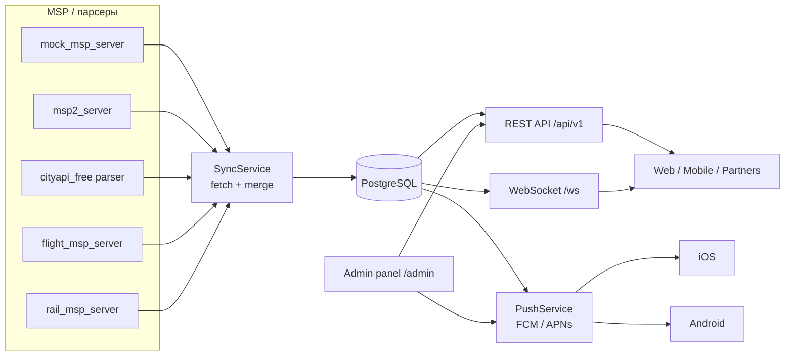
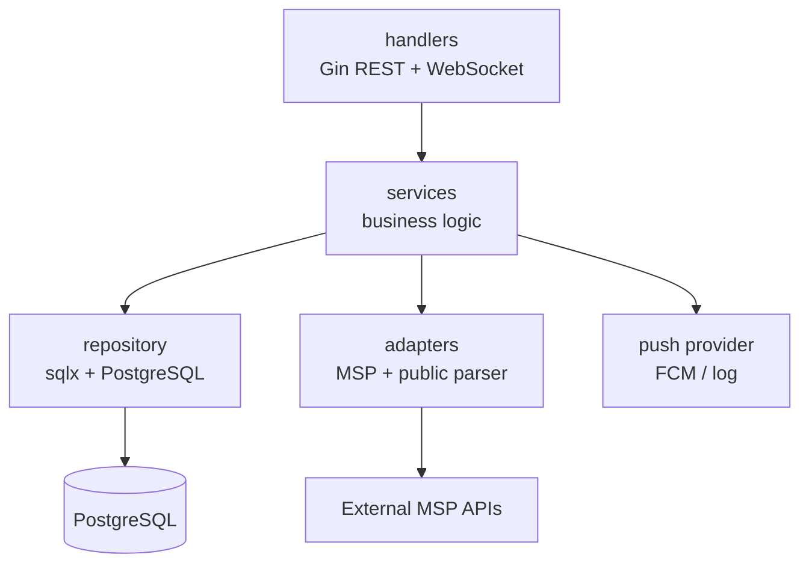

# Архитектура GoTravel

GoTravel — backend-прослойка между клиентом и несколькими travel MSP-серверами.

## Поток данных



## Слои



- `handler` — HTTP-контракты, валидация входа, коды ответов.
- `service` — сценарии: синхронизация, мерж, билеты, заказы, push.
- `repository` — SQL, upsert по `(source, external_id)`, пагинация.
- `adapter` — интеграции с MSP и публичными источниками.
- `model` — доменные структуры и JSON-контракты.

## Синхронизация

1. `POST /api/v1/sync` запускает обход всех источников.
2. Для каждого источника создаётся запись в `sync_jobs`.
3. Загружаются destinations, tours и tickets (если источник поддерживает).
4. Данные сохраняются через upsert, поэтому повторная синхронизация не создаёт дубликаты.
5. Туры привязываются к направлениям, билеты доступны для фильтрации по городу, типу и дате.
6. Клиент получает уже объединённые данные из одного API.

## Источники

| Источник | Назначение |
|---|---|
| `mock_msp_server` | демо-направления, туры, билеты |
| `msp2_server` | второй MSP: туры и билеты |
| `cityapi_free` | публичный парсер стран/столиц |
| `flight_msp_server` | авиабилеты |
| `rail_msp_server` | ЖД-билеты |

Новый источник подключается реализацией интерфейса:

```go
type Source interface {
    Name() string
    FetchDestinations(context.Context) ([]model.Destination, error)
    FetchTours(context.Context) ([]model.Tour, error)
}

type TicketSource interface {
    FetchTickets(context.Context) ([]model.Ticket, error)
}
```

Достаточно добавить источник в `service.NewSyncService(...)` в `cmd/server/main.go`.

## Push-уведомления

- Клиент регистрирует FCM/APNs токен через `POST /api/v1/devices/register`.
- Админ отправляет уведомление через `POST /api/v1/admin/push` или панель `/admin`.
- `PushService` выбирает получателей: конкретный `user_id` или все активные устройства.
- При наличии `FCM_SERVER_KEY` используется Firebase Cloud Messaging (Android и iOS).
- Без ключа включается `log`-провайдер для локальной разработки.

## Хранение геолокации

WebSocket-хаб хранит подключения и позиции в памяти процесса. Для нескольких инстансов приложения нужен общий pub/sub (Redis, NATS или Kafka).
