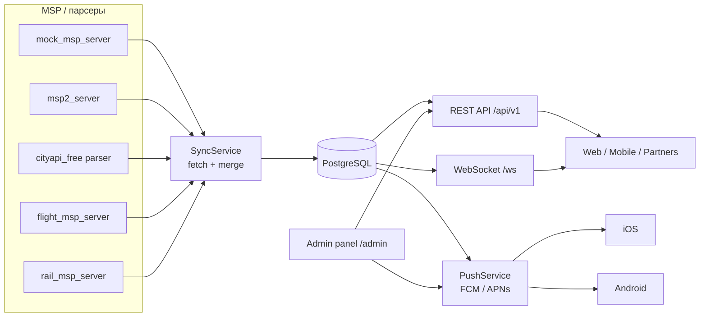
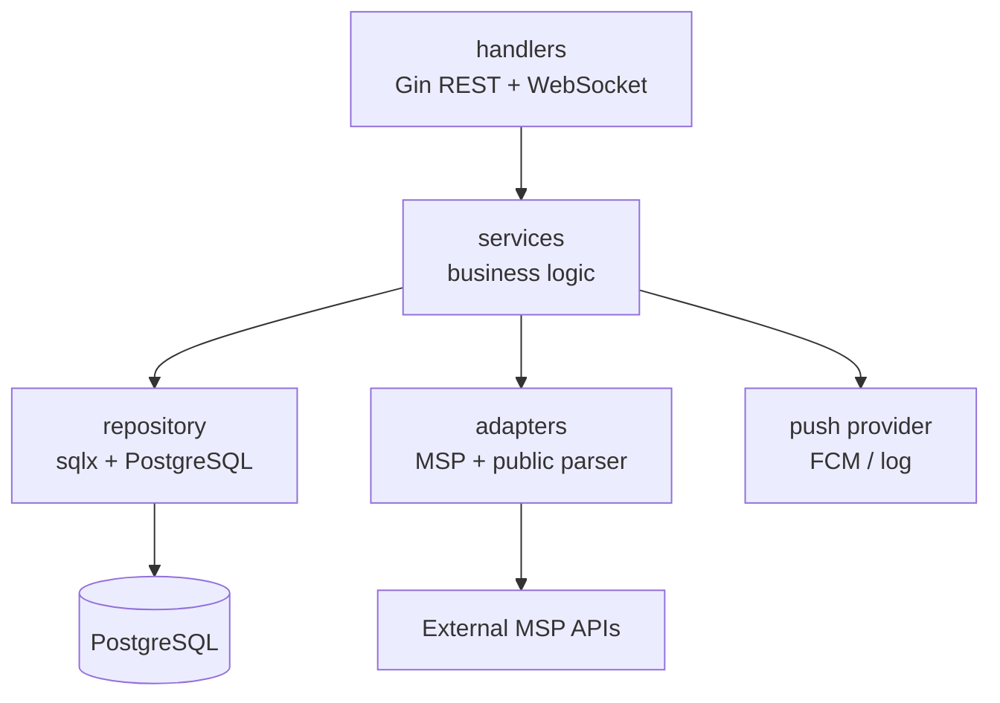
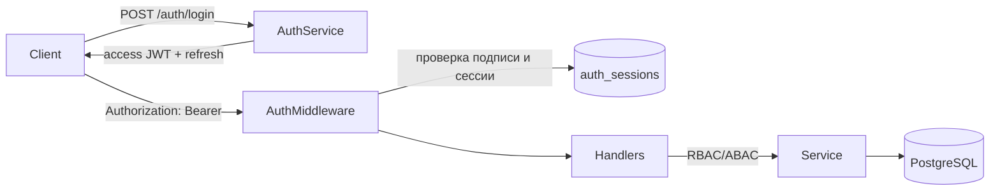
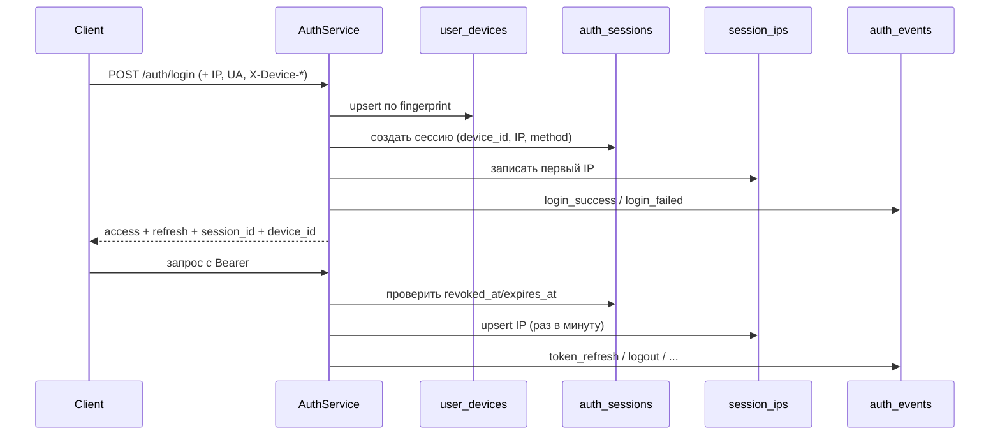

# Архитектура GoTravel

GoTravel — backend-прослойка между клиентом и несколькими travel MSP-серверами.

## Поток данных



## Слои



- `handler` — HTTP-контракты, валидация входа, коды ответов.
- `service` — сценарии: синхронизация, мерж, билеты, заказы, push.
- `repository` — SQL, upsert по `(source, external_id)`, пагинация.
- `adapter` — интеграции с MSP и публичными источниками.
- `model` — доменные структуры и JSON-контракты.

## Синхронизация

1. `POST /api/v1/sync` запускает обход всех источников.
2. Для каждого источника создаётся запись в `sync_jobs`.
3. Загружаются destinations, tours и tickets (если источник поддерживает).
4. Данные сохраняются через upsert, поэтому повторная синхронизация не создаёт дубликаты.
5. Туры привязываются к направлениям, билеты доступны для фильтрации по городу, типу и дате.
6. Клиент получает уже объединённые данные из одного API.

## Источники

| Источник | Назначение |
|---|---|
| `mock_msp_server` | демо-направления, туры, билеты |
| `msp2_server` | второй MSP: туры и билеты |
| `cityapi_free` | публичный парсер стран/столиц |
| `flight_msp_server` | авиабилеты |
| `rail_msp_server` | ЖД-билеты |

Новый источник подключается реализацией интерфейса:

```go
type Source interface {
    Name() string
    FetchDestinations(context.Context) ([]model.Destination, error)
    FetchTours(context.Context) ([]model.Tour, error)
}

type TicketSource interface {
    FetchTickets(context.Context) ([]model.Ticket, error)
}
```

Достаточно добавить источник в `service.NewSyncService(...)` в `cmd/server/main.go`.

## Push-уведомления

- Клиент регистрирует FCM/APNs токен через `POST /api/v1/devices/register`.
- Админ отправляет уведомление через `POST /api/v1/admin/push` или панель `/admin`.
- `PushService` выбирает получателей: конкретный `user_id` или все активные устройства.
- При наличии `FCM_SERVER_KEY` используется Firebase Cloud Messaging (Android и iOS).
- Без ключа включается `log`-провайдер для локальной разработки.

## Аутентификация и безопасность



- **Access token** — JWT HS256, содержит `sub`, `sid`, `role`, `exp`; секрет задаётся
  `JWT_SECRET` (в Docker — переменная compose), по умолчанию dev-значение. В production
  сервер не стартует без `JWT_SECRET`.
- **Refresh token** — непрозрачная строка, в БД хранится только SHA-256 хеш. При каждом
  обновлении токен ротируется: `UPDATE` содержит старый хеш в предикате, поэтому две
  параллельные ротации не могут обе succeed — повторное использование старого токена
  трактуется как reuse и отклоняется.
- **Сессии** (`auth_sessions`) хранят `device_id`, device name, platform, IP, user-agent,
  время логина, `last_seen_at`, `last_ip`, `last_method`, `request_count`, срок жизни и
  `revoked_at`. Middleware обязателен: JWT без `sid` или с отозванной/просроченной
  сессией отклоняется. `last_seen_at` обновляется с троттлингом раз в минуту.
- **Устройства** (`user_devices`) — агрегация сессий по fingerprint (`sha256` от
  платформы, user-agent и имени). Хранят первый/последний IP, счётчик входов, флаги
  `trusted`/`blocked`, время первого и последнего входа. Блокировка устройства
  автоматически отзывает его сессии.
- **IP-история** (`session_ips`) — каждая пара `(session_id, ip)` с количеством
  запросов и временем первого/последнего обращения. Используется в
  `/auth/sessions/{id}/ips` и `/auth/devices/{id}`.
- **Аудит** (`auth_events`) — единая лента всех событий аутентификации: регистрация,
  входы (успешные/неуспешные/заблокированные), MFA, passkeys, OAuth, refresh, logout,
  смена пароля, действия с устройствами и админские блокировки. Хранит `user_id`,
  `email`, `event`, `success`, `reason`, `session_id`, `device_id`, `ip`, `user_agent`,
  `platform`, `device_name`, `request_id`, `metadata` и `created_at`.
- **MFA** (`user_mfa`) — TOTP SHA1/6 цифр/30 секунд, совместим с Google Authenticator.
  Секрет выдаётся через `/auth/mfa/setup`, включается подтверждением кода. Сервер
  принимает текущий шаг ±1, но успешно использованный шаг пишется в `last_step` и
  повторно не принимается (replay protection).
- **Passkeys** (`passkey_credentials`) — WebAuthn challenge + `clientDataJSON` проверяются
  на сервере; подпись attestation/assertion проверяется платформой (документированное
  ограничение).
- **OAuth2/OIDC** (`oauth_codes`) — authorization code живёт 5 минут, одноразовый,
  PKCE только `S256`. `GET /oauth/authorize` отвечает `302` на `redirect_uri`, `POST`
  возвращает JSON. `id_token` — HS256, `/oauth/jwks` возвращает пустой набор ключей.
  Ответы token-эндпоинта содержат `scope` и `device_id` и идут с `Cache-Control: no-store`.
- **RBAC** — роли `user`, `guide`, `partner`, `admin`; middleware отклоняет запросы без
  нужной роли (403).
- **ABAC** — гид ограничен `tours.owner_id`, партнёр — `orders.partner_id`; проверки
  выполняются и в списках, и при чтении/изменении конкретной записи.
- **Блокировки** — `users.blocked` + `blocked_reason` (админ), `user_devices.blocked`
  (владелец или админ). Заблокированный аккаунт или устройство получает `403`, а все
  его сессии отзываются.
- **Anti-bruteforce** — lockout после `security.max_failed_logins` неудачных попыток за
  `security.lockout_minutes` (ответ `429`), плюс per-IP rate limiting.
- **Legacy header auth** — `X-User-Id`/`X-User-Role` доступен только при явном
  `security.allow_header_auth: true`; в production всегда отключён.

## Трекинг аутентификации



Поток данных:

1. `deviceInfo(c)` собирает IP (`c.ClientIP()` с учётом `trusted_proxies`), User-Agent,
   платформу и имя устройства, а также `X-Request-Id`.
2. `startSession` делает upsert устройства, проверяет блокировку, создаёт сессию,
   пишет первый IP и событие успеха.
3. Middleware при каждом запросе проверяет сессию и пользователя, обновляет
   `session_ips`/`last_seen_at` не чаще раза в минуту.
4. Все ошибки входа (неверный пароль, несуществующий email, lockout, блокировка)
   фиксируются в `auth_events` с причиной.
5. Пользователь видит свои события в `/auth/login-history`, сводку — в
   `/auth/security/summary`; администратор — в `/admin/security/*` и панели `/admin`.

## Rate limiting, заголовки и janitor

- `middleware.AdaptiveRateLimit` использует два token-bucket лимитера на процесс:
  общий (`rate_limit.requests_per_minute`, по умолчанию 120) и строгий для
  `/auth/*`, `/oauth/authorize`, `/oauth/token` (`auth_requests_per_minute`, 10).
  При превышении — `429` и `Retry-After: 60`. Для нескольких инстансов нужен общий
  лимитер на уровне gateway/Redis.
- `middleware.RequestID` гарантирует `X-Request-Id` (из заголовка или случайный),
  `SecurityHeaders` добавляет `X-Content-Type-Options`, `X-Frame-Options`,
  `Referrer-Policy`, `Permissions-Policy`; `/api/v1` отдаётся с `Cache-Control: no-store`.
- `service.StartJanitor` раз в `security.session_cleanup_minutes` (30) отзывает
  просроченные сессии, удаляет истёкшие OAuth-коды, старые `session_ips` и события
  старше `security.event_retention_days` (180).
- `trusted_proxies` — список IP/CIDR; пустой список означает «не доверять
  `X-Forwarded-For`», чтобы клиент не мог подделать IP в аудите.

## Пул подключений PostgreSQL

`schema`-миграции выполняются при старте, после чего пул настраивается:

| Параметр | По умолчанию | Env |
|---|---|---|
| `max_open_conns` | 25 | `DB_MAX_OPEN_CONNS` |
| `max_idle_conns` | 10 | `DB_MAX_IDLE_CONNS` |
| `conn_max_lifetime` | 5m | `DB_CONN_MAX_LIFETIME` |
| `conn_max_idle_time` | 2m | — |

Значения из `configs/config.yaml` переопределяются переменными окружения. При старте
в лог пишется `db pool configured` с фактическими параметрами — это удобно проверять
в `docker compose logs app`.

## Хранение геолокации

WebSocket-хаб хранит подключения и позиции в памяти процесса. Для нескольких инстансов приложения нужен общий pub/sub (Redis, NATS или Kafka).
