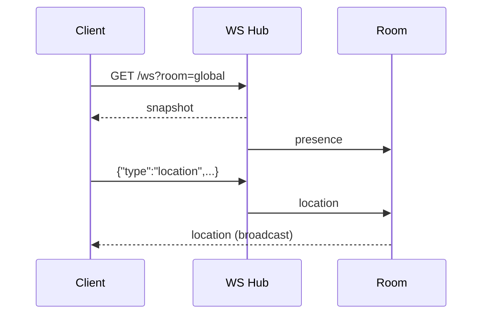

# GoTravel WebSocket

WebSocket используется для геолокации, presence и обмена событиями в реальном времени.

## Подключение

```
ws://localhost:8080/ws?room=global&user_id=<uuid>&name=Traveler
wss://your-domain.example/ws?room=global&user_id=<uuid>&name=Traveler
```

Дополнительный алиас: `ws://localhost:8080/ws/events` (тот же обработчик).

| Параметр | Обязательный | По умолчанию | Описание |
|---|---|---|---|
| `room` | нет | `global` | Комната/группа |
| `user_id` | нет | случайный UUID | ID пользователя |
| `name` | нет | `Guest` | Отображаемое имя |

`user_id` также можно передать заголовком `X-User-Id`.

## Формат сообщений

Все сообщения — JSON-объекты с полем `type`.

### Клиент → сервер

Геолокация:

```json
{
  "type": "location",
  "location": {
    "lat": 55.7558,
    "lng": 37.6173,
    "accuracy": 12
  }
}
```

Смена комнаты:

```json
{
  "type": "join",
  "room": "room-1"
}
```

Произвольное сообщение (чат/событие) — уходит всем в комнате, кроме отправителя:

```json
{
  "type": "chat",
  "message": "Привет!"
}
```

### Сервер → клиент

Снимок комнаты при подключении:

```json
{
  "type": "snapshot",
  "room": "global",
  "payload": [
    {
      "id": "<connection-uuid>",
      "user_id": "<user-uuid>",
      "name": "Traveler",
      "location": { "lat": 55.75, "lng": 37.62, "accuracy": 5 }
    }
  ]
}
```

Обновление списка участников:

```json
{
  "type": "presence",
  "room": "global",
  "payload": [
    {
      "id": "<connection-uuid>",
      "user_id": "<user-uuid>",
      "name": "Traveler",
      "location": { "lat": 55.75, "lng": 37.62 }
    }
  ]
}
```

Трансляция геолокации (получают все в комнате, включая отправителя):

```json
{
  "type": "location",
  "room": "global",
  "user_id": "<user-uuid>",
  "name": "Traveler",
  "location": { "lat": 55.75, "lng": 37.62, "accuracy": 5 }
}
```

## Пример на JavaScript

```js
const ws = new WebSocket(
  "ws://localhost:8080/ws?room=global&user_id=11111111-2222-3333-4444-555555555555&name=Traveler"
);

ws.onopen = () => {
  setInterval(() => {
    ws.send(JSON.stringify({
      type: "location",
      location: { lat: 55.7558, lng: 37.6173, accuracy: 10 }
    }));
  }, 3000);
};

ws.onmessage = (event) => {
  const msg = JSON.parse(event.data);
  if (msg.type === "presence") {
    console.log("online:", msg.payload);
  }
  if (msg.type === "location") {
    console.log("moved:", msg.user_id, msg.location);
  }
};
```

## Пример на Python

```python
import json
import websocket

ws = websocket.create_connection(
    "ws://localhost:8080/ws?room=global&user_id=11111111-2222-3333-4444-555555555555&name=Tester"
)

print(ws.recv())  # snapshot

ws.send(json.dumps({
    "type": "location",
    "location": {"lat": 55.75, "lng": 37.62, "accuracy": 5}
}))

for _ in range(3):
    print(ws.recv())  # presence / location

ws.close()
```

## Правила работы

- Сообщения больше 64 KB отбрасываются.
- Сервер отправляет ping каждые 54 секунды.
- Нет pong/сообщений 120 секунд — соединение закрывается.
- При подключении клиент получает `snapshot` и `presence`.
- `location` обновляет позицию и рассылается всей комнате.
- `join` переключает комнату и присылает новый `snapshot`.
- `chat` и другие типы рассылаются всем в комнате, кроме отправителя.
- Hub хранится в памяти процесса: для нескольких инстансов нужен общий брокер (Redis pub/sub, NATS, Kafka).

## Проверка вручную

1. Откройте Swagger UI и выполните `POST /api/v1/sync`, чтобы появились данные.
2. Подключитесь к `/ws` из Postman или браузера.
3. Отправьте `location` и проверьте входящие `location`/`presence`.

Диаграмма:


